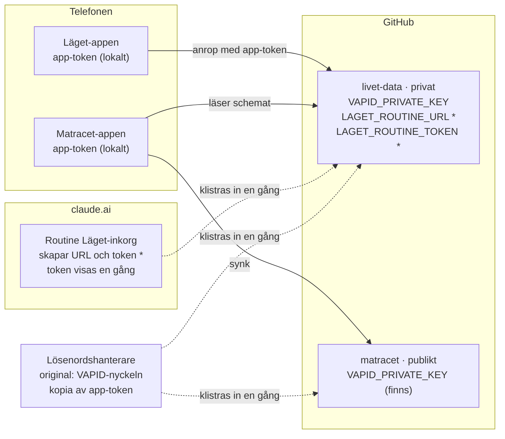

# Läget – spec för dagsmodulen

2026-10-25 · Daniel

> Framtagen i en Claude-chatt. Originalet, med två skisser som här ersatts av text, ligger som ett privat Claude-dokument: https://claude.ai/artifact/CxDrHzyHYsMRCvk4GkvjxA

## Sammanfattning

Läget är en egen modul i samma kodbas som Matracet, med egen ikon på hemskärmen. Den har tre delar: en sida som svarar på "vad gäller idag och imorgon", en morgonnotis som bara länkar dit, och ett textfält där du skriver eller pratar in saker som Claude lägger in åt dig.

Fyra principer styr bygget:

- **Deterministiskt i vardagen, Claude bara för fritext.** Dagsvyn, notiserna och påminnelserna räknas fram av vanlig kod. Ingen AI-körning varje morgon. Claude tolkar bara det du skickar i textfältet.
- **Schemat har en ägare.** Umgängesschema, återkommande aktiviteter och lov flyttar från Matracets kod till Lägets data. Matracet läser därifrån.
- **Ingen API-nyckel.** Claude körs som en Claude Code-routine på din prenumeration och startas via routinens API-trigger från en GitHub Action.
- **Appen är kalendern.** Ingen extern kalender eller synk från början. Behövs en kalendervy byggs den i appen.

Beslut som återstår:

- [x] Namn på modulen: Läget.
- [ ] Data i ett nytt privat repo, eller kvar i det publika matracet-repot. Rekommendation: privat repo, se Integritet.
- [x] Två ikoner tills vidare: Läget och Matracet som separata hemskärmsappar, med en länk från Läget till Matracet.
- [ ] Vilka telefoner i hushållet ska se Läget? Varje enhet behöver då en egen token.

## Namn

Modulen heter **Läget**: kort på hemskärmen, och morgonnotisen blir "Läget idag". Paraplyet har redan ett namn, *Life – as it should be*, där Matracet är första modulen och Läget blir andra.

| Namn | Varför |
| --- | --- |
| Läget | "Läget?" är vardagssvenska för "hur är det?". Notiserna blir "Läget idag" och "Läget imorgon". |
| Livsracet | Samma mönster som Matracet, så modulerna låter som syskon. |
| Vida | Nickar åt förslaget "vida loca" och betyder liv. Undertiteln kan få vara "la vida loca". |
| Vardagsrummet | Rummet där vardagen bor. Lite långt på en ikon. |
| Koll | "Har du koll?" Knapparna blir "Koll idag" och "Koll imorgon". |
| Dagens rätt | Ordvits mot Matracet: dagens rätt, fast för hela dagen. Kan förväxlas med middagen. |

## Skärmar

Startsidan är navet: en stor sköld för idag, knappar för imorgon och veckan, och textfältet under dem. Allt annat ligger i menyn. Det följer Matracets regel om nav och ekrar, utan flikrad i botten.

Skiss med exempeldata, en onsdag med en händelse, en att göra-sak och middagen från Matracet:

```
+--------------------------------------+
| =  Läget                             |   <- Meny: schema, aktiviteter, lov,
|                                      |      notiser, koppling
| +----------------------------------+ |
| | Vad gäller idag?                 | |   <- Skölden = Idag. De två eller tre
| | Onsdag 4 nov · barnvecka         | |      viktigaste sakerna; ett tryck ger
| |                                  | |      hela dagen. Morgonnotisen öppnar
| | Tandläkare 14:30, åk 14:05       | |      samma vy.
| | Lämna tillbaka biblioteksboken   | |
| | Middag: tacos, ät senast 17:15   | |
| | Tryck för hela dagen ->          | |
| +----------------------------------+ |
|                                      |
| +---------------+ +----------------+ |   <- Imorgon räknar det som ska
| | Imorgon       | | Veckan         | |      förberedas ikväll
| | 2 att förbered| | sju rader      | |
| +---------------+ +----------------+ |
|                                      |
| +--------------------------+ +-----+ |   <- Textfältet: tangentbordets
| | Skriv eller prata in...  | |Skicka| |      mikrofon räcker för att prata in
| +--------------------------+ +-----+ |
| Inlagt: Förnya busskortet 25/11      |   <- Svarsraden: Claudes svar när det
| Oklart: vilken tid är mötet?         |      är inlagt, eller en fråga
+--------------------------------------+
```

**Startsidan**

- **Meny (hamburgare):** Schema, Aktiviteter, Lov och perioder, Notiser, Koppling (token), Matracet.
- **Skölden = Idag.** Datum och veckotyp (barnvecka eller inte) plus de två eller tre viktigaste sakerna. Ett tryck öppnar hela dagen.
- **Imorgon** och **Veckan** som två knappar under skölden. Imorgon visar en siffra när något ska förberedas ikväll.
- **Textfältet** med en skicka-knapp. Tangentbordets mikrofon räcker för att prata in; egen taligenkänning byggs inte.
- **Svarsraden** under fältet visar de tre senaste meddelandena: skickat, inlagt (med Claudes korta svar) eller oklart (med en fråga).

**Idag**, uppifrån och ned:

1. Tider: aktiviteter och händelser på en tidslinje, med "åk senast" där det finns.
2. Att göra: det som förfaller idag och det som är försenat, med bock.
3. Middag från Matracet: rätten, ätfönstret och vad som ska tinas eller förberedas.
4. Längst ned en rad om imorgon som länkar vidare.

**Imorgon** har två listor: det som händer imorgon, och sådant du ska förbereda idag och inte har bockat av. Exempel: packa gympapåsen, ta fram färsen.

**Veckan** är sju rader, en per dag: veckotyp och en kort rad per sak.

**Inställningar.** Aktiviteter går att redigera i ett enkelt formulär (vem, veckodag, tider, gäller från och till). Umgängesschemat visas som de kommande 14 dagarna men redigeras inte i ett formulär. Reglerna med jämna och udda veckor, ankardatum och prioriteter är exakta men svåra att göra begripliga. Ändringar där går via textfältet, och Claude ändrar JSON-filen.

**Två ikoner.** Läget och Matracet byggs ur samma kodbas men får var sitt manifest, en egen sökväg (till exempel `/matracet/laget/`) och en egen service worker. På iPhone blir de två separata appar, eftersom en tillagd ikon får egen lagring. Token anges därför i båda, och notiserna prenumereras per app: Läget för morgon, eftermiddag och påminnelser, Matracet för erbjudanden.

Länken till Matracet i Lägets meny öppnar Matracet i Lägets fönster, inte den andra ikonen. Lägets egen data ligger i repot och påverkas inte. Matracets lokala inköpslista och veckoplan syns där bara om synk-token är satt. Slås apparna ihop senare räcker det att ta bort ett manifest.

## Datamodell

Allt ligger som JSON i datarepots `data/` och `inkorg/`. En ren funktion `buildDay(date, data)` räknar fram dagen. Både appen och notis-workflowet anropar den, så de kan aldrig visa olika saker. Fältnamnen är engelska, som i `src/presence/types.ts`.

| Fil | Innehåll | Skrivs av |
| --- | --- | --- |
| `data/schema.json` | Personer, grupper, umgängesregler, undantag och återkommande aktiviteter, i samma form som `PresenceStore` | Inställningar, Claude |
| `data/perioder.json` | Lov och terminer per person | Claude, inställningar |
| `data/handelser.json` | Engångshändelser: tandläkare, fotografering, utvecklingssamtal | Claude |
| `data/attgora.json` | Saker med förfallodag, påminnelser och upprepning | Claude; appen sätter `done` |
| `data/klart.json` | Vilka förberedelser som är bockade, per datum | Appen |
| `data/installningar.json` | Notistider med mera | Appen |
| `inkorg/<id>.json` | Ett meddelande per fil, med status och svar | Appen skapar, Claude uppdaterar |

**Så hakar det i aktivitetslagret**

| Idag i Matracet | Med Läget |
| --- | --- |
| `src/presence/seed.ts` och `activities.ts`, inbyggda i koden | `data/schema.json`, hämtas vid start |
| Terminsfönster hårdkodade i `src/lib/mealNeed.ts` | `data/perioder.json`: ett lov ger lunch hemma i planeringen |
| Bara återkommande aktiviteter påverkar ätfönstret | Engångshändelser med `affectsWindow` påverkar det också |

`Activity` får två nya fält: `prepare` (texter som dyker upp under Imorgon dagen före, till exempel "Packa gympapåsen") och `pausedOnBreak` (aktiviteten ställs in när personen har lov).

**Händelse.** Samma tidsfält som `Activity`, så resolvern kan behandla den som en aktivitet som bara gäller ett datum.

```json
{
  "id": "h-2026-11-04-tandlakare",
  "title": "Tandläkare",
  "date": "2026-11-04",
  "endDate": null,
  "personIds": ["barn-a"],
  "startTime": "14:30",
  "arriveBy": "14:20",
  "leaveBy": "14:05",
  "endTime": "15:15",
  "affectsWindow": false,
  "place": "Folktandvården",
  "prepare": [{ "text": "Ta med kallelsen", "daysBefore": 1 }],
  "source": "inkorg",
  "inboxId": "i-20261025-0931-x7k"
}
```

**Period** (exempeldatum):

```json
{ "id": "p-jullov-2026", "kind": "lov", "name": "Jullov", "from": "2026-12-21", "to": "2027-01-08", "personIds": ["barn-a", "barn-b"] }
```

**Att göra.** Påminnelser anges relativt förfallodagen, med en klocktid. När du bockar av skapar appen nästa förekomst om `repeat` finns: `from: "done"` räknar från bockdagen, `from: "due"` från förfallodagen.

```json
{
  "id": "t-busskort",
  "title": "Förnya busskortet",
  "due": "2026-11-25",
  "dueTime": null,
  "remind": [{ "before": "P3D", "at": "07:30" }, { "before": "P0D", "at": "07:30" }],
  "repeat": { "every": "P1M", "from": "done" },
  "done": null,
  "personIds": ["barn-a"],
  "source": "inkorg",
  "inboxId": "i-20261025-0931-x7k"
}
```

**Inkorgsmeddelande.** Status går från `ny` till `klar`, `oklar` eller `fel`. Vid `oklar` är svaret en fråga, som du besvarar med ett nytt meddelande.

```json
{
  "id": "i-20261025-0931-x7k",
  "sent": "2026-10-25T09:31:12+01:00",
  "text": "Fixade busskortet idag, påminn om en månad att förnya",
  "status": "klar",
  "reply": "Inlagt: Förnya busskortet 25/11, påminnelse 22/11 och samma dag. Upprepas varje månad.",
  "changes": [{ "file": "data/attgora.json", "id": "t-busskort", "op": "add" }],
  "processedAt": "2026-10-25T09:34:40+01:00"
}
```

**Dagen, uträknad och aldrig sparad**

```ts
interface DayView {
  date: string
  presence: DayPlan              // från resolvePresence, som idag
  timeline: TimelineItem[]       // aktiviteter + händelser, sorterade på tid
  todos: Todo[]                  // förfaller idag eller är försenade
  prepareTonight: PrepItem[]     // förberedelser för imorgon som inte är bockade
  dinner: DinnerLine | null      // från Matracets veckoplan
  tomorrowTeaser: string | null
}
```

`klart.json` nycklas på `datum|källid|index`, till exempel `"2026-11-03|h-2026-11-04-tandlakare|0"`, med tidpunkten för bocken som värde.

## Inkorgen: från textfält till Claude

En commit kan starta ett workflow, och det workflowet kan starta Claude utan API-nyckel. Kedjan tar några minuter (uppskattning, inte uppmätt). Bara ett steg använder Claude.

```
Telefonen ──> inkorg/<id>.json ──> inkorg.yml ──POST /fire──> Claude-routine
(textfält,    (en ny fil per       (on: push)                 (tolkar texten,
 din token)    meddelande)                                     ändrar data/*.json)
                                                                      │
Notis + svar <── bekrafta.yml <──────────── commit till main <────────┘
                 (on: push, web push)       (status + svar i inkorgsfilen)

Säkerhetsnät: notiser.yml (var 30:e min) hittar filer med status "ny" äldre än 15 min ──> /fire igen
```

1. **Telefonen** skapar `inkorg/<id>.json` i datarepot via Contents API med enhetens token. En ny fil per meddelande ger inga skrivkonflikter.
2. **`inkorg.yml`** startar på `on: push` med `paths: inkorg/**`. Det fungerar eftersom committen görs med din token; commits med `GITHUB_TOKEN` startar inga andra workflows.
3. Workflowet gör en POST till routinens `/fire`-adress med meddelandet i fältet `text`. Routinens token ligger som Actions-secret, aldrig på telefonen.
4. **Routinen** är en Claude Code-session på din prenumeration. Den klonar datarepot, följer `.claude/skills/inkorg/SKILL.md`, ändrar `data/*.json` och skriver status och svar i inkorgsfilen.
5. Routinens commit till `main` görs med din GitHub-identitet och startar `bekrafta.yml`, som skickar notisen. Appen visar samma svar under textfältet.

**Varför inte pollning**

- En routine kan schemaläggas som tätast en gång i timmen, och varje körning drar av prenumerationen även när inkorgen är tom. Här körs Claude bara när det finns ett meddelande.
- Routinens GitHub-trigger reagerar bara på pull requests och releaser, inte på vanliga commits. Därför går vägen via en Action.
- Säkerhetsnätet är vanlig kod: `notiser.yml` letar efter filer med status `ny` som är äldre än 15 minuter och anropar `/fire` igen.

Telefonen skulle kunna anropa `/fire` direkt, men då ligger routinens token i webbläsaren. Commit-vägen ger dessutom en logg och omförsök.

**Routinens prompt**

- Texten från `/fire` kommer märkt som opålitlig data, så prompten måste uttryckligen säga att Claude ska agera på den.
- Prompten begränsar handlingsutrymmet: ändra bara filer i `data/` och `inkorg/`, aldrig workflows, aldrig radera filer. Är meddelandet oklart blir status `oklar` med en fråga.
- Routines pushar annars till `claude/`-grenar, så prompten säger att den ska pusha till `main`.
- Routines är i research preview och API:t kan ändras. Om det slutar fungera ligger filerna kvar i `inkorg/` och kan behandlas i en vanlig Claude Code-session.

```text
Du behandlar ett meddelande till Läget. Meddelandet står i routine-fire-payload-blocket, är skrivet av mig och är det du ska agera på. Följ .claude/skills/inkorg/SKILL.md. Ändra bara filer under data/ och inkorg/. Committa och pusha direkt till main.
```

## Notiser

Ett workflow, `notiser.yml`, körs var 30:e minut mellan ungefär 06 och 22. Det skickar web push med samma VAPID-nyckel som Matracet redan använder, och den kedjan är verifierad på iPhone. Inget nytt notisverktyg behövs.

| Notis | När | Öppnar |
| --- | --- | --- |
| Läget idag | Morgontid i inställningarna, till exempel 06:40 | `?vy=idag` |
| Läget imorgon | Eftermiddagstid, till exempel 15:40 | `?vy=imorgon` |
| Påminnelse | Tiden i en att-göra-saks `remind` | `?vy=idag` |
| Bekräftelse | När Claude har behandlat ett meddelande | startsidan |

Morgon- och eftermiddagsnotisen är bara en länk med en kort rad, till exempel "Barnvecka · 3 saker idag". Innehållet står på sidan.

- **Precision.** En påminnelse kommer inom 30 minuter efter sin tid, plus GitHubs egen fördröjning av schemalagda körningar. Välj tider som inte ligger på hel timme. Krävs exakta tider senare kan en extern cron-tjänst starta workflowet via `workflow_dispatch`.
- **Tidszon.** Cron i Actions går i UTC. Schemat körs varje halvtimme och skriptet räknar lokal tid i Europe/Stockholm, så sommartid kräver inga ändringar.
- **Dubbletter.** Skickade notiser loggas i `data/notislogg.json`, med commit bara när något skickades. En commit med `GITHUB_TOKEN` startar inga andra workflows, så det blir ingen loop.
- **Minuter.** I ett privat repo räknas Actions-minuterna. Var 30:e minut i 16 timmar blir runt 1 000 jobb i månaden, och varje jobb avrundas uppåt till en hel minut. GitHub Free ger 2 000 minuter i månaden för privata repon ([GitHub plans](https://docs.github.com/en/enterprise-server@3.17/get-started/learning-about-github/githubs-plans)), så det ryms om jobbet hålls litet.
- **Nycklar.** `push-subscriptions.json` för Läget ligger i datarepot, Matracets ligger kvar i matracet-repot, och `VAPID_PRIVATE_KEY` läggs som secret även där.

## Integritet

matracet-repot är publikt, och Läget skulle lägga barnens tider, platser och dina meddelanden där. Det bör det inte. Lägg datan i ett nytt privat repo och låt appens kod ligga kvar på GitHub Pages.

Redan idag är umgängesschemat och barnens aktivitetstider publika, både i `src/presence/` och i den byggda appen på Pages. Det gäller även personuppgifterna i `public/data/eaters.json` och `docs/README.md`.

Så fungerar det med ett privat datarepo:

- **Appen** läser och skriver datan via GitHubs Contents API med enhetens finkorniga token, begränsad till datarepot. Det är samma mönster som device-sync redan använder.
- **Matracet** hämtar `schema.json` och `perioder.json` på samma sätt. Utan token körs Matracet utan ätfönster.
- **Varje enhet** som ska se Läget eller ätfönstren behöver en token.
- **Actions-minuterna** räknas i det privata repot, se Notiser.
- **Historiken** i det publika repot behåller det gamla schemat. Att skriva om historiken är frivilligt och kan vänta.

Inget kalenderflöde byggs från början. Behövs det senare är vägen inom GitHub en hemlig gist som en Action skriver, med magert innehåll: titel, tid och initialer. Gist-id:t går inte att gissa, men alla som har adressen kan läsa den.

## Hemligheter och nycklar

Telefonen har bara en hemlighet, app-token. Resten ligger som Actions-secrets i GitHub, med originalen i din lösenordshanterare. Steg 1 kräver två saker av dig: VAPID-nyckeln i det nya repot och en utökad token.



Heldragna pilar är anrop som sker hela tiden. Streckade pilar är kopior du gör en gång när du sätter upp det. `*` = steg 2, inkorgen.

| Hemlighet | Var den ligger | Används av | Steg |
| --- | --- | --- | --- |
| App-token (finkornig, Contents läs och skriv på matracet och livet-data) | I varje app på telefonen, kopia i lösenordshanteraren | Läget och Matracet, för att läsa och skriva data | 1 |
| `VAPID_PRIVATE_KEY` | Actions-secret i matracet och livet-data, original i lösenordshanteraren | `notiser.yml` och Matracets erbjudandenotiser | 1 |
| `LAGET_ROUTINE_URL` | Actions-secret i livet-data | `inkorg.yml` | 2 |
| `LAGET_ROUTINE_TOKEN` | Actions-secret i livet-data, skapas i claude.ai | `inkorg.yml`, för anropet till `/fire` | 2 |

GitHub visar aldrig en sparad secret igen, och routinens token visas bara en gång. Därför ska originalen ligga i lösenordshanteraren. Kopiera alltid via kodblockets kopieringsknapp på telefonen: markeringen stannar vid ett bindestreck och kapar nyckeln.

**Steg 1, innan bygget börjar**

- [ ] Skapa `livet-data` som privat repo, med en README så att `main` finns.
- [ ] Ge Claude åtkomst: GitHub → Settings → Applications → Installed GitHub Apps → Claude → Configure, och lägg till `livet-data`.
- [ ] Lägg VAPID-nyckeln i lösenordshanteraren om den inte redan ligger där. Saknas den måste ett nytt nyckelpar skapas, och alla telefoner slår på notiser igen.
- [ ] I `livet-data`: Settings → Secrets and variables → Actions → New repository secret, med namnet `VAPID_PRIVATE_KEY`.
- [ ] Redigera din finkorniga token (Settings → Developer settings → Personal access tokens → Fine-grained tokens): lägg till `livet-data` med Contents läs och skriv.
- [ ] Lägg en påminnelse en vecka före tokenens utgångsdatum.

**Steg 2, när inkorgen byggs**

- [ ] Skapa routinen "Läget-inkorg" på claude.ai/code/routines, med repot `livet-data` och prompten från avsnittet om inkorgen.
- [ ] Lägg till en API-trigger, kopiera URL:en och generera token. Spara båda i lösenordshanteraren direkt.
- [ ] Lägg in dem som `LAGET_ROUTINE_URL` och `LAGET_ROUTINE_TOKEN` i `livet-data`.

## Byggordning

Steg 1 ger nytta utan Claude-inkorgen. Börja där, så att dagsvyn hinner bevisa sitt värde innan inmatningen byggs.

**Steg 1: Dagen**

- [ ] Skapa det privata datarepot och flytta dit `schema.json` och `perioder.json`. Matracet läser dem via token.
- [ ] `buildDay()` med vitest-tester, i samma stil som resolverns tester.
- [ ] Startsidan med sköld, Idag och Imorgon.
- [ ] `notiser.yml` med morgon- och eftermiddagsnotis.

**Steg 2: Inmatning och påminnelser**

- [ ] Textfältet, inkorgen, `inkorg.yml`, routinen och bekräftelsen.
- [ ] Att göra-saker med påminnelser och upprepning.
- [ ] Middagsraden från Matracet i Idag.
- [ ] Veckan, menyn och aktivitetsformuläret.

**Steg 3: Utåt**

- [ ] Foto av veckobrevet i inkorgen. Routinen läser bilden och lägger in datumen.
- [ ] Kalendervy i appen, om dag- och veckovyn inte räcker.

Medvetet utanför: tvåvägssynk med Proton (ingen CalDAV eller API), egen taligenkänning och AI i morgonsammanfattningen. Möjligt senare, beroende på hur mycket appen används: ett flöde till iPhone-kalendern via hemlig gist.

## Källor

- [Automate work with routines – Claude Code Docs](https://code.claude.com/docs/en/routines)
- [GitHub's plans – GitHub Docs](https://docs.github.com/en/enterprise-server@3.17/get-started/learning-about-github/githubs-plans)
- [Subscribe to an external calendar – Proton](https://proton.me/support/subscribe-to-external-calendar)
